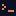
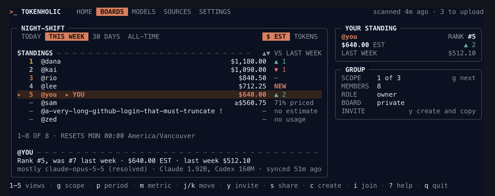
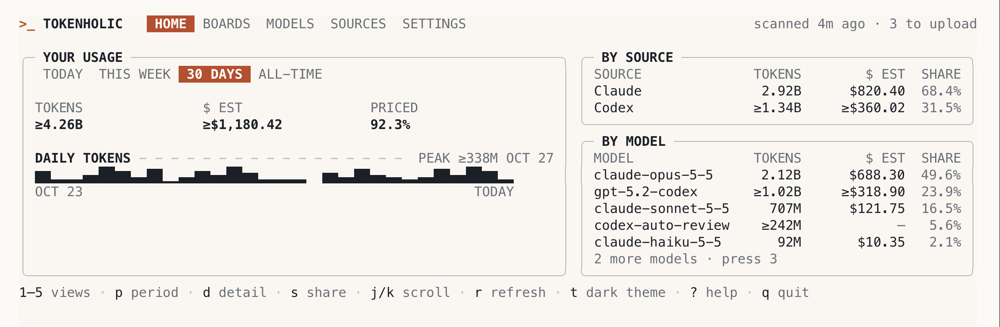

<div align="center">



# tokenholic

### How many tokens did your coding agents burn?

A terminal leaderboard for your AI coding-agent usage. tokenholic reads the usage
records your agents already keep on your machine, totals them in your
terminal, and ranks you against the friends you invite.

[](https://www.npmjs.com/package/@tokenholic/cli)
[](https://github.com/ansonnchan/tokenholic/actions/workflows/ci.yml)
[](CONTRIBUTING.md)
[](LICENSE)

[**Website → ansonnchan.github.io/tokenholic**](https://ansonnchan.github.io/tokenholic/) &nbsp;·&nbsp; [Quickstart](#quickstart) &nbsp;·&nbsp; [How it works](#how-it-works) &nbsp;·&nbsp; [Privacy](#privacy)



<sub>Sample data. The real thing runs in your terminal.</sub>

</div>

---

## Quickstart

```sh
npx @tokenholic/cli        # see your usage locally, no login required
```

That's it. Nothing is uploaded and no account is created. After a global
install (`npm install --global @tokenholic/cli`) the command is `tokenholic`:

```sh
tokenholic                 # local dashboard, with the option to claim
tokenholic show-data       # print the exact payload before anything is sent
tokenholic claim           # sign in with GitHub, then upload
tokenholic group create "EXAMPLE_GROUP_NAME"
```

Runs on macOS, Linux, and Windows. Every command is in the
[command reference](docs/commands.md).

## Works with

`Claude Code` · `Codex` · `Gemini CLI` · `OpenCode` · `Copilot CLI` · `Grok Build CLI` · `Qwen Code`

Claude and Codex are read natively. The other five are read as
daily totals through a pinned [ccusage](https://github.com/ccusage/ccusage),
which comes with the npm package and can be turned off with
`tokenholic ccusage off`.

## How it works

- One command scans the usage records your agents already write **on your
  machine** and opens a dashboard: tokens, an API-equivalent estimate, models,
  and sources.
- Claiming with GitHub uploads **token counts only**, after you confirm what
  is sent. Groups are private and invite-only; a public profile or board is
  something you turn on.
- Costs are estimates at API list prices, never what you spent. An unknown
  value is shown as unknown, never as zero.
- Sync when you run it, or hourly in the background if you enable it.

<div align="center">

</div>

## Privacy

tokenholic counts usage. It does not inspect work. It never uploads or keeps
prompts, responses, source code, command text, file paths, project or
repository names, branch names, credentials, or transcripts. What is uploaded
is token counts by category, the model ID, which agent, and a UTC time bucket.
`tokenholic show-data` prints that payload, byte for byte, without an account.

## Documentation

- [Command reference](docs/commands.md)
- [Architecture](docs/architecture.md) and [design](docs/design.md)
- [Development guide](docs/development.md) and [all documentation](docs/README.md)
- [Roadmap](ROADMAP.md)

## Contributing

Found a bug, or want an agent or feature added? Open an
[issue](https://github.com/ansonnchan/tokenholic/issues). See
[CONTRIBUTING.md](CONTRIBUTING.md).

## License

[MIT](LICENSE).
