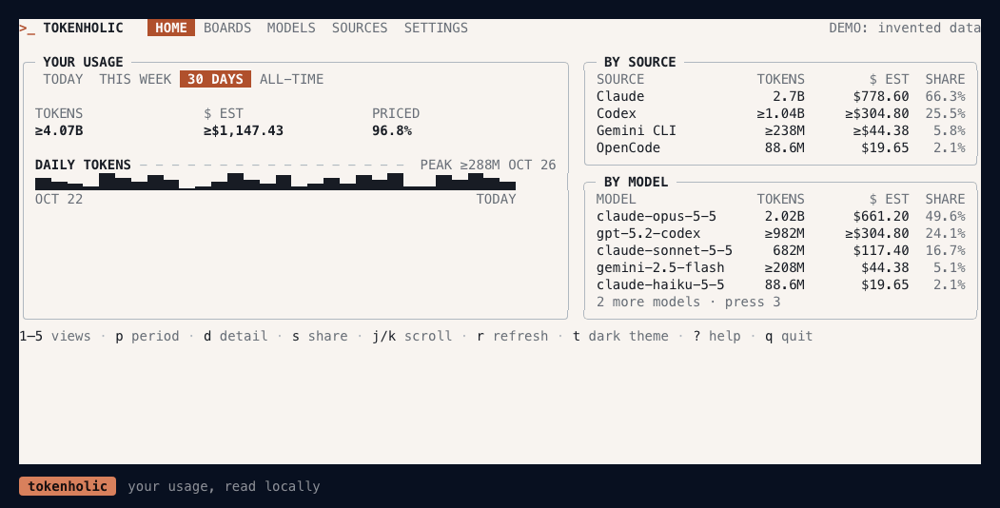

# tokenholic

**How many tokens did your coding agents burn?**

A terminal leaderboard for your AI coding-agent usage. tokenholic reads the
usage records your agents already keep on your machine, totals them in your
terminal, and ranks you against the friends you invite.



## Try it

```sh
npx @tokenholic/cli
```

No login, and nothing is uploaded. Runs on macOS, Linux, and Windows.

```sh
tokenholic demo     # the same dashboard on invented data
tokenholic claim    # sign in with GitHub to join boards
```

## Works with

Claude Code · Codex · Gemini CLI · OpenCode · Copilot CLI · Grok Build CLI · Qwen Code

## Privacy

Only token counts ever leave your machine, and only after you claim an
account. Never prompts, responses, code, paths, or project names.
`tokenholic show-data` prints exactly what would be sent.

## More

[Website](https://ansonnchan.github.io/tokenholic/) ·
[Documentation and source](https://github.com/ansonnchan/tokenholic) ·
[Issues](https://github.com/ansonnchan/tokenholic/issues) · MIT
